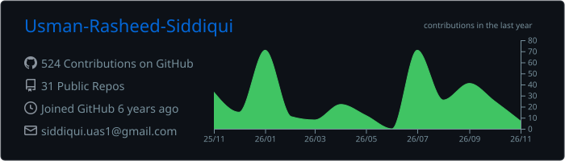
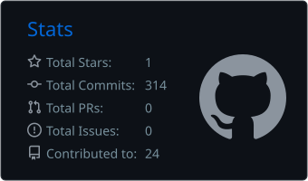
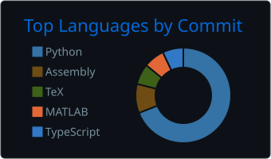
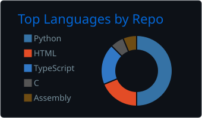
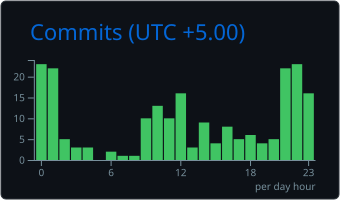

<p align="center">
  
</p>

<p align="center">
  
</p>

<p align="center">
  <a href="https://www.linkedin.com/in/usman-rasheed-siddiqui/"></a>
  <a href="https://github.com/Usman-Rasheed-Siddiqui"></a>
</p>

## About

Computer Systems Engineering student at **NED University of Engineering & Technology**, focused on building practical software systems across **backend development, AI, data, APIs and blockchain**. I enjoy turning ideas into working projects, from REST APIs and AI-powered applications to smart contracts and processor designs.

- Head of Team Coding & Innovation, CIS Community
- Organizer, ZeroToShip | Summer Activity 2026
- NED Iqbal Leadership Fellowship, 2026

---

## Tech Stack

### Languages


### Backend & APIs


### Frontend


### Computer Architecture & Digital Systems


### AI & Data


### Blockchain


### Tools & Other Technologies


---

## Featured Projects

### F1 Educational Platform
Educational Formula 1 platform combining structured F1 data with an AI assistant.

- Django REST API backend serving drivers, constructors, circuits, races and results
- F1-focused AI assistant with page-aware context and database querying (Gemini API)
- Integration with trusted live F1 data sources

**Tech:** React · TypeScript · Tailwind CSS · Django REST Framework · PostgreSQL · Supabase · Gemini API

### RISC-V Processor & Custom CPU (Logisim)
RISC-V-based processor built in Logisim for Computer Organization & Design / Digital Logic Design coursework.

- Implemented and connected the core datapath components
- Worked with RISC-V instruction formats and execution
- Designed a custom processor architecture as an extension of the base implementation

**Tech:** RISC-V · Logisim · Digital Logic · Computer Architecture

### Skills-Based Certificate Issuing System
Ethereum smart-contract system that issues skill-based certificates based on predefined eligibility requirements.

- Role-based authorization, skill records and eligibility validation
- Certificate issuance and revocation

```text
Citizen + Skills  →  Validation  →  Certificate
```

**Tech:** Solidity · Ethereum · Remix IDE · MetaMask

---

## Leadership: CIS Community

**ZeroToShip | Summer Activity 2026** is a guided, project-based coding activity that helps students go from an idea to a completed, documented project. As Head of Team Coding & Innovation, I handled:

- Activity planning, phase-based workflow and project guidance
- Submission and evaluation processes, final project evaluation
- Certificate coordination and sponsor/participant communication

---

## GitHub Stats

<p align="center">
  
  
</p>

<p align="center">
  
  
  
</p>

### Contribution Graph

<p align="center">
  
</p>

---

## Currently Exploring

AI agents and LLM applications · AI + REST API integration · Data cleaning and provenance · Blockchain-based integrity systems · Scalable backend architecture · Database design · Full-stack development

## Coursework

Object-Oriented Programming · Data Structures & Algorithms · Database Management Systems · Computer Networks · Digital Logic Design · Computer Architecture · Artificial Intelligence · Machine Learning · Blockchain Technologies

## University Labs & Learning Resources

I share subject-wise lab work, practicals and learning resources (C, Python, OOP, DSA, Cisco Packet Tracer networking, AI/ML, digital logic and computer architecture, Solidity) to help batch mates and juniors.

> These resources are shared for learning and reference. Use them to understand the concepts and build your own solutions rather than copying.

---

## Contact

<p>
  <a href="https://www.linkedin.com/in/usman-rasheed-siddiqui/"></a>
  <a href="https://github.com/Usman-Rasheed-Siddiqui"></a>
</p>
